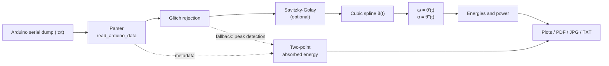
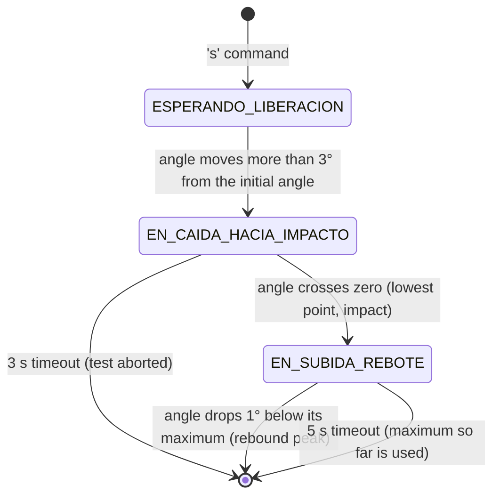
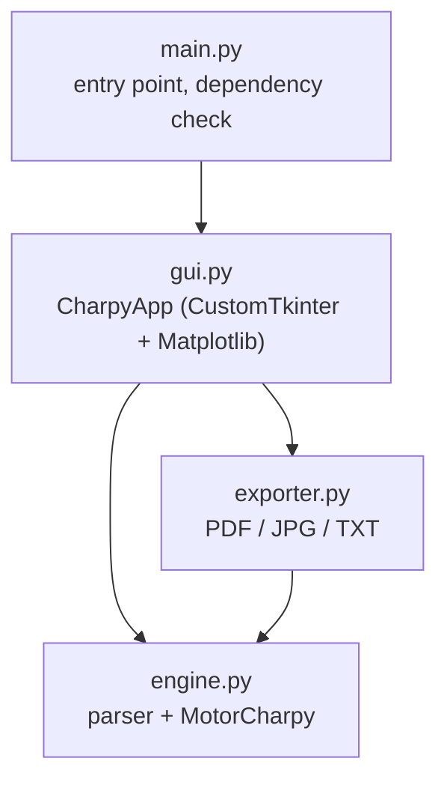

# Charpy Impact Analysis

Desktop application for analysing data from a home-built **Charpy impact test pendulum** (Arduino Uno + E38S6G5-600B-G24N incremental encoder). It reads the angle-vs-time table captured by the firmware, reconstructs the pendulum motion with a **cubic spline**, differentiates it analytically to obtain angular velocity and acceleration, and derives the energy absorbed by the specimen, the energy curves and the instantaneous power.


## Table of contents

- [Features](#features)
- [How it works](#how-it-works)
- [Hardware and firmware](#hardware-and-firmware)
  - [Wiring](#wiring)
  - [Quadrature decoding](#quadrature-decoding)
  - [Test state machine](#test-state-machine)
  - [Sampling and storage](#sampling-and-storage)
  - [Serial commands](#serial-commands)
  - [Flashing and running a test](#flashing-and-running-a-test)
- [Mathematical background](#mathematical-background)
  - [Cubic spline interpolation](#cubic-spline-interpolation)
  - [Differentiating the spline](#differentiating-the-spline)
  - [Noise amplification and optional smoothing](#noise-amplification-and-optional-smoothing)
  - [Pendulum physics](#pendulum-physics)
  - [Robustness heuristics](#robustness-heuristics)
- [Architecture](#architecture)
- [System Architecture](#system-architecture)
- [Downloads](#downloads)
  - [Running the application on Windows](#running-the-application-on-windows)
  - [Building the executable yourself](#building-the-executable-yourself)
- [Installation](#installation)
- [Usage](#usage)
  - [Input file format](#input-file-format)
  - [Graphical interface](#graphical-interface)
  - [Command line](#command-line)
  - [Using the engine as a library](#using-the-engine-as-a-library)
  - [Exports](#exports)
- [Known limitations](#known-limitations)
- [License](#license)

## Features

- **Tolerant parser** for the Arduino serial dump: ignores banners and unrelated serial output, accepts tab, space, `;` or `,` as column separator, decimal comma or point, CRLF or LF, unordered rows and duplicated timestamps.
- **Automatic metadata extraction** (initial angle, rebound angle, friction loss) when the firmware's result block is present in the same file.
- **Cubic spline reconstruction** of the angle signal, with exact analytical first and second derivatives.
- **Energy analysis**: absorbed energy (gross and friction-corrected), potential, kinetic and total mechanical energy, and instantaneous power.
- **Moment of inertia** entered manually or estimated from the small-amplitude oscillation period.
- **Encoder glitch rejection** and optional **Savitzky–Golay** pre-smoothing.
- **Reliability flag**: the app warns when the rebound angle had to be estimated from a truncated capture.
- **Pendulum animation**: a playback tab replays the reconstructed swing frame by frame, in slow motion, with the angle curve and a synced cursor.
- **Exports**: PDF report, JPG plots and a tab-separated table of processed data.

## How it works



1. The file is parsed into a time vector (converted from microseconds to seconds, relative to the first sample) and an angle vector in degrees.
2. Single-sample encoder glitches are repaired.
3. Optionally, the angle is pre-smoothed with a Savitzky–Golay filter.
4. A cubic spline is fitted to the angle in radians and evaluated, together with its first two derivatives, on a uniform grid of 400 points (or on the original sampling instants).
5. Energies and power are computed from the spline; the absorbed energy is computed with the same two-point formula used by the firmware.

## Hardware and firmware

The data analysed by this application is produced by the Arduino sketch in [`charpy_final_1/charpy_final_1.ino`](charpy_final_1/charpy_final_1.ino). It runs on an **Arduino Uno (ATmega328P)** and uses a single external peripheral: an **E38S6G5-600B-G24N** incremental rotary encoder (600 pulses per revolution, quadrature A/B outputs) mounted on the pendulum axis. There is no display and the sketch needs no external libraries; all interaction goes through the serial port at **115200 baud**.

### Wiring

| Encoder wire | Arduino Uno | Notes |
|---|---|---|
| VCC | 5V | Use an external 9–12 V supply instead if the encoder does not respond at 5 V. |
| GND | GND | Must be common with the Arduino, also when the encoder is powered externally. |
| A | D2 (INT0) | External interrupt pin. |
| B | D3 (INT1) | External interrupt pin. |
| Shield / drain (if present) | GND | |

The encoder outputs are NPN open-collector, so both pins are configured as `INPUT_PULLUP`.

### Quadrature decoding

Both channels are attached to external interrupts triggered on `CHANGE`, so every edge of A and of B is counted (×4 decoding):

```math
600 \times 4 = 2400 \text{ counts per revolution} \quad\Rightarrow\quad 0.15^\circ \text{ per count}
```

The interrupt routine is kept as short as possible:

1. It reads both pins in a single access to the `PIND` port register instead of two `digitalRead()` calls.
2. It combines the previous and the current 2-bit A/B state into a 4-bit index.
3. It looks that index up in a 16-entry transition table, stored in flash (`PROGMEM`), which returns `+1`, `-1` or `0`. Invalid transitions (both bits changing at once) yield `0`, so they do not corrupt the count.
4. It adds the result to a signed 32-bit counter.

The main loop converts the counter to degrees. Because a 32-bit read is not atomic on an 8-bit microcontroller, the counter is copied with interrupts briefly disabled. The angle is relative to the zero set with the `z` command (pendulum hanging at rest), and its sign indicates the side of the swing.

### Test state machine

After the `s` command the firmware follows the swing with a small state machine, so that the capture starts and stops on the actual motion rather than on timers or key presses:



- **Waiting for release** (`ESPERANDO_LIBERACION`). Nothing is recorded and no timer runs while the pendulum is held; the operator can take as long as needed.
- **Falling towards the impact** (`EN_CAIDA_HACIA_IMPACTO`). The sample buffer and the time origin are reset at the moment the release is detected. Sampling continues until the angle changes sign with respect to the initial angle, which marks the passage through the lowest point, where the specimen sits.
- **Rising after the impact** (`EN_SUBIDA_REBOTE`). The maximum angle, in magnitude, is tracked on every loop iteration, restarting from the zero crossing. The peak is confirmed as soon as the angle has dropped more than 1° below that maximum, a threshold well above the 0.15° quantisation step. The firmware does not wait for the pendulum to come to rest.

When the peak is confirmed, the capture stops and the result block is printed automatically. The absorbed energy uses the two-point formula described in [Pendulum physics](#pendulum-physics), with the mass and the pivot-to-centre-of-mass radius defined as constants at the top of the sketch.

### Sampling and storage

- **Rate.** While a test is in progress, the loop stores a sample whenever at least 3500 µs have passed since the previous one. This is a polling threshold, not a hardware timer, so the spacing is slightly irregular; each sample carries its own `micros()` timestamp, and the analysis does not assume a uniform grid.
- **Buffer.** Up to 300 samples, which gives a capture window of about 1.05 s from the release. According to the design notes in the sketch, a release from 150° takes about 484 ms to reach the specimen, so the window covers the fall and the rebound.
- **Memory.** Each sample takes 4 bytes: the time elapsed since the previous sample as a `uint16_t` in microseconds, and the angle multiplied by 100 as an `int16_t`. The full buffer uses 1200 of the 2048 bytes of SRAM on the Uno. Absolute timestamps are rebuilt by accumulating the deltas when the table is printed.
- **Rebound angle.** The rebound maximum is tracked independently of the buffer, at the full loop rate, and keeps being updated even when the buffer is full.
- **Serial output.** The live angle readout is suppressed during a capture, so no printing delays the sampling loop.

### Serial commands

Each command is a single character sent from the serial monitor:

| Command | Action |
|---|---|
| `z` | Sets the current position as zero. Use it with the pendulum hanging at rest. |
| `i` | Stores the current angle as the initial (release) angle. |
| `s` | Arms the capture. The test starts when the pendulum is released. |
| `e` | Recomputes and prints the result block (initial angle, rebound angle, gross energy and, once calibrated, friction loss and net energy). |
| `c` | After a swing **without a specimen**, stores the energy lost in that swing as the friction loss. It is subtracted from later results. |
| `d` | Prints the time/angle table of the last test. |
| `m` | Prints the estimated free RAM (diagnostics). |

While idle, the firmware prints the current angle and a text bar every 100 ms. The output is formatted so that the parser in `engine.py` only picks up the data table and the result lines; see [Input file format](#input-file-format).

### Flashing and running a test

1. Open `charpy_final_1/charpy_final_1.ino` in the Arduino IDE.
2. Set `masa_pendulo` (kg) and `radio_centro_masa` (m) at the top of the sketch to the values of your pendulum. Use the same values later in the desktop application.
3. Select the **Arduino Uno** board and its port, and upload.
4. Open the serial monitor at 115200 baud.
5. With the pendulum hanging at rest, send `z`.
6. Optional, to calibrate friction: raise the pendulum, send `i` and `s`, release it with no specimen in place, wait for the result block and send `c`.
7. Place the specimen, raise the pendulum to the release angle and send `i`, then `s`, and release it.
8. After the result block appears, send `d` to print the data table.
9. Copy the serial monitor output, including the result block and the table, into a `.txt` file and load it in the application.

## Mathematical background

### Cubic spline interpolation

The encoder provides $`n+1`$ samples $`(t_i, \theta_i)`$, $`i = 0, \dots, n`$, with strictly increasing times. A cubic spline is a piecewise polynomial $`S(t)`$ that on each interval $`[t_i, t_{i+1}]`$ is a cubic:

```math
S_i(t) = a_i + b_i\,(t - t_i) + c_i\,(t - t_i)^2 + d_i\,(t - t_i)^3 , \qquad i = 0, \dots, n-1
```

This gives $`4n`$ unknown coefficients, determined by the following conditions:

| Condition | Equations | Count |
|---|---|---|
| Interpolation | $`S_i(t_i) = \theta_i`$ and $`S_i(t_{i+1}) = \theta_{i+1}`$ | $`2n`$ |
| Continuous first derivative | $`S_{i-1}'(t_i) = S_i'(t_i)`$ at interior knots | $`n-1`$ |
| Continuous second derivative | $`S_{i-1}''(t_i) = S_i''(t_i)`$ at interior knots | $`n-1`$ |
| Boundary conditions | see below | $`2`$ |

The result is a curve of class $`C^2`$: position, velocity and acceleration are all continuous, which is exactly what a physical trajectory requires.

**Boundary conditions.** The project uses `scipy.interpolate.CubicSpline` with its default *not-a-knot* condition: the third derivative is also required to be continuous at the second and the second-to-last knots,

```math
S_0'''(t_1) = S_1'''(t_1) , \qquad S_{n-2}'''(t_{n-1}) = S_{n-1}'''(t_{n-1})
```

so the first two and the last two segments are each a single cubic. Unlike the *natural* spline ($`S'' = 0`$ at both ends), this does not impose zero angular acceleration at the boundaries, which would be physically wrong for a pendulum released from a large angle.

**Solving the system.** Writing $`h_i = t_{i+1} - t_i`$ and $`M_i = S''(t_i)`$, the continuity of the first derivative at each interior knot yields a tridiagonal linear system:

```math
h_{i-1} M_{i-1} + 2\,(h_{i-1} + h_i)\,M_i + h_i M_{i+1}
= 6 \left( \frac{\theta_{i+1} - \theta_i}{h_i} - \frac{\theta_i - \theta_{i-1}}{h_{i-1}} \right) , \qquad i = 1, \dots, n-1
```

Together with the two boundary equations it is solved in $`O(n)`$ operations. The coefficients of each segment then follow directly:

```math
a_i = \theta_i , \qquad
b_i = \frac{\theta_{i+1} - \theta_i}{h_i} - \frac{h_i\,(2 M_i + M_{i+1})}{6} , \qquad
c_i = \frac{M_i}{2} , \qquad
d_i = \frac{M_{i+1} - M_i}{6\,h_i}
```

At least 4 distinct samples are required; the parser enforces this.

### Differentiating the spline

Because each segment is a polynomial, the derivatives are obtained **analytically**, with no finite differences:

```math
\omega(t) = S_i'(t) = b_i + 2 c_i\,(t - t_i) + 3 d_i\,(t - t_i)^2
```

```math
\alpha(t) = S_i''(t) = 2 c_i + 6 d_i\,(t - t_i)
```

The angular velocity $`\omega`$ is piecewise quadratic and the angular acceleration $`\alpha`$ is piecewise linear and continuous. For a sufficiently smooth underlying function and sample spacing $`h`$, the approximation errors are of order $`h^4`$ for $`\theta`$, $`h^3`$ for $`\omega`$ and $`h^2`$ for $`\alpha`$: each differentiation costs one order of accuracy.

### Noise amplification and optional smoothing

`CubicSpline` is an *exact interpolator*: it passes through every sample, including the quantisation noise of the encoder. The encoder has 600 pulses per revolution decoded in quadrature, so the angular resolution is

```math
\delta = \frac{360^\circ}{600 \times 4} = 0.15^\circ \text{ per count}
```

With the firmware's sampling step $`h = 3.5\ \text{ms}`$, an error $`\delta`$ in the angle is amplified roughly as $`\delta / h`$ in the velocity (on the order of $`43^\circ/\text{s}`$) and as $`\delta / h^2`$ in the acceleration (on the order of $`1.2 \times 10^4\ {}^\circ/\text{s}^2`$). The angle curve looks smooth, but acceleration and power can show a meaningless high-frequency sawtooth.

To mitigate this, the angle can be pre-filtered with a **Savitzky–Golay** filter before building the spline. For each sample, the filter fits a polynomial of degree 3 by least squares to a window of $`2k+1`$ neighbouring samples and replaces the sample with the value of that polynomial, which preserves the shape of peaks better than a moving average. The window must be an odd integer $`\geq 5`$ and no larger than the number of samples; values of 9 or 11 are a good starting point. Smoothing is disabled by default.

### Pendulum physics

Let $`m`$ be the pendulum mass, $`R`$ the distance from the pivot to the centre of mass, $`I`$ the moment of inertia about the pivot and $`g`$ the gravitational acceleration (9.81 m/s² by default). Angles are measured from the lowest point.

**Potential energy**, relative to the lowest point:

```math
E_p(t) = m\,g\,R\,\bigl(1 - \cos\theta(t)\bigr)
```

Since the cosine is an even function, the sign of the angle is irrelevant and no absolute value is applied to the signal.

**Kinetic and total mechanical energy** (only when $`I`$ is provided):

```math
E_k(t) = \tfrac{1}{2}\,I\,\omega(t)^2 , \qquad E(t) = E_k(t) + E_p(t)
```

**Instantaneous power** is the time derivative of the total energy. It is evaluated in closed form from the spline derivatives rather than by differentiating the energy numerically a further time:

```math
P(t) = \frac{dE}{dt} = \omega(t)\,\bigl[\,I\,\alpha(t) + m\,g\,R\,\sin\theta(t)\,\bigr]
```

**Absorbed energy (two-point method).** This is the standard Charpy result and replicates the formula used by the firmware, with $`\theta_0`$ the release angle and $`\theta_f`$ the maximum rebound angle:

```math
E_{\text{gross}} = m\,g\,R\,\bigl(\cos\theta_f - \cos\theta_0\bigr) , \qquad
E_{\text{net}} = \max\bigl(0,\; E_{\text{gross}} - E_{\text{friction}}\bigr)
```

**Experimental moment of inertia.** For small oscillations a physical pendulum has period $`T = 2\pi\sqrt{I / (m g R)}`$, hence

```math
I = \frac{T^2\,m\,g\,R}{4\pi^2}
```

This assumes small amplitudes (below about 15°). Measure $`T`$ by timing $`N`$ free oscillations without a specimen, released from a few degrees, and dividing by $`N`$.

### Robustness heuristics

**Encoder glitch rejection.** Always applied, before any smoothing. A sample is treated as a glitch when it differs from *both* immediate neighbours by more than 8° while those two neighbours agree with each other to within 4°. It is replaced by the average of its neighbours, so the time grid is unchanged. The order matters: after a Savitzky–Golay pass a glitch is smeared across several samples and can no longer be recognised.

**Rebound angle.** The rebound angle is chosen in this order of preference:

1. The value reported by the firmware in the file's metadata. The firmware tracks the maximum angle in real time, independently of its sample buffer, so this is the most accurate source.
2. Otherwise, the first peak (in $`\theta`$ or $`-\theta`$) found by `scipy.signal.find_peaks` with a minimum prominence of 0.5° and a minimum width of 10 samples. The width requirement is what separates a physical turning point, which builds up over tens of samples, from a spurious spike.
3. Otherwise, the last angle in the table, flagged as **not reliable**. This happens when the capture ends before the pendulum reaches its turning point, and it tends to **overestimate** the absorbed energy.

## Architecture

The code is split into three layers with a one-way dependency: the GUI depends on the exporter and the engine, the exporter depends on the engine, and the engine depends on nothing but NumPy and SciPy.



| File | Responsibility |
|---|---|
| `main.py` | Entry point. Checks that the required packages and `tkinter` are available and prints installation hints instead of a traceback, then launches the GUI. |
| `engine.py` | File parser and physics engine. No GUI dependencies; can be used as a library or from the command line. |
| `gui.py` | `CharpyApp` window: file loading, parameter entry, result display, four static plot tabs and a pendulum animation tab. Contains no physics: the animation only replays the spline already computed by `engine.py`. |
| `exporter.py` | PDF report (ReportLab), JPG plots and processed-data TXT. Independent of the GUI. |
| `requirements.txt` | Python dependencies. |
| `charpy_final_1/charpy_final_1.ino` | Arduino Uno firmware that acquires the data. See [Hardware and firmware](#hardware-and-firmware). |

Main elements of `engine.py`:

| Name | Kind | Description |
|---|---|---|
| `read_arduino_data(filepath)` | function | Parses the file and returns an `EnsayoData`. Raises `ArduinoDataError` if no valid rows or fewer than 4 distinct samples are found. |
| `EnsayoData` | dataclass | Time in seconds, angle in degrees and the extracted `ArduinoMetadata`. |
| `ParametrosFisicos` | dataclass | Mass, pivot-to-centre-of-mass radius, optional moment of inertia and `g`. |
| `MotorCharpy.analizar(...)` | method | Runs the full pipeline and returns a `ResultadoAnalisis`. |
| `ResultadoAnalisis` | dataclass | Raw data, spline curves, energies, power, absorbed energy, the angles used and the `rebote_confiable` reliability flag. |
| `calcular_energia_absorbida_dos_puntos(...)` | function | Two-point absorbed energy, gross and net. |
| `calcular_inercia_experimental(...)` | function | Moment of inertia from the oscillation period. |

Identifiers, comments and GUI labels are written in Spanish and mirror the variable names used in the Arduino firmware, which is included in the `charpy_final_1/` folder.

## System Architecture

The graph below maps the dependencies and relationships between the Python scripts, the Arduino firmware and the documentation. It was generated with [graphify](https://github.com/safishamsi/graphify): the Python files were analysed structurally (imports, calls, classes), and the firmware, this README and `requirements.txt` were added through semantic extraction.


Each dot is a file, class, function, firmware element or documented concept, and each line is a relationship such as an import, a call, shared data or a reference. Colours mark the seven communities found by clustering:

| Community | Main contents |
|---|---|
| Arduino firmware | The functions of `charpy_final_1.ino`, the test state machine, the sample buffer and the encoder. |
| Serial data contract | `imprimirTablaDatos()` and `imprimirBloqueResultado()` in the firmware, together with `read_arduino_data()` and `ArduinoMetadata` in the engine, which parse their output. |
| Spline analysis and maths | `MotorCharpy.analizar()`, glitch rejection, rebound estimation, the two-point energy formula and the README sections that describe them. |
| Physics engine and parameters | `engine.py`, `MotorCharpy`, `ParametrosFisicos` and the moment of inertia calculation. |
| Graphical interface (CharpyApp) | The `CharpyApp` class in `gui.py` and `ResultadoAnalisis`. |
| Result export | `exporter.py` (PDF, JPG and TXT). |
| Startup and dependencies | `main.py`, its dependency check and `requirements.txt`. |

The most connected nodes are `CharpyApp`, `ParametrosFisicos`, `exportar_reporte_pdf()`, `ResultadoAnalisis`, `read_arduino_data()` and the firmware's `loop()`. The links between the firmware and the Python code go through the serial log format and the shared two-point energy formula; there is no direct call between the two.

The image is a simplified view with 98 of the 153 nodes: docstring nodes and external modules are left out, and only the main nodes are labelled. The complete, interactive graph is in [`graph.html`](graph.html) at the root of the repository. GitHub shows that file as source code, so download it or clone the repository and open it in a browser; it loads the vis-network library from the internet. Its community names are in Spanish.

## Downloads

A ready-to-run Windows build of the graphical interface is published on the [Releases page](https://github.com/aloks93/charpy-impact-analysis/releases/latest). It is a single file, `CharpyImpactAnalysis.exe` (about 75 MB), that bundles Python and all the dependencies, so nothing else has to be installed. The executable is not stored in the repository itself.

### Running the application on Windows

Requires 64-bit Windows 10 or later.

1. Open the [latest release](https://github.com/aloks93/charpy-impact-analysis/releases/latest) and, under **Assets**, download `CharpyImpactAnalysis.exe`.
2. Move it to any folder and double-click it. No installation or administrator rights are needed.
3. The executable is not digitally signed, so Windows SmartScreen may show a "Windows protected your PC" dialog the first time. Click **More info** and then **Run anyway**.
4. Wait for the window titled *Analizador de Ensayo Charpy* to appear. Each start takes several seconds, because the single-file build unpacks itself to a temporary folder first.
5. Continue with [Graphical interface](#graphical-interface).

The executable contains only the desktop application. The Arduino firmware is uploaded separately; see [Flashing and running a test](#flashing-and-running-a-test). To remove the application, delete the `.exe` file.

### Building the executable yourself

The build uses [PyInstaller](https://pyinstaller.org). From the project folder, with the dependencies from [Installation](#installation) already installed:

```bash
pip install pyinstaller
pyinstaller --noconfirm --clean --onefile --windowed --name CharpyImpactAnalysis --collect-data customtkinter --exclude-module PySide6 --exclude-module shiboken6 --exclude-module PySide2 --exclude-module PyQt5 --exclude-module PyQt6 main.py
```

The result is written to `dist/CharpyImpactAnalysis.exe`. `--collect-data customtkinter` bundles the theme files that CustomTkinter loads at run time, and the `--exclude-module` options keep Qt bindings out of the build if they happen to be installed, since Matplotlib is only used with its Tk backend. The `build/` and `dist/` folders, `*.spec` and `*.exe` files are listed in `.gitignore`.

## Installation

These steps are for running the application from source. Requires Python 3.9 or later (developed with Python 3.12).

```bash
git clone https://github.com/aloks93/charpy-impact-analysis.git
cd charpy-impact-analysis
python -m venv .venv
```

Activate the virtual environment:

```bash
# Windows (PowerShell)
.venv\Scripts\Activate.ps1

# Linux / macOS
source .venv/bin/activate
```

Install the dependencies:

```bash
pip install -r requirements.txt
```

| Package | Used for |
|---|---|
| `numpy` | Array computation |
| `scipy` | `CubicSpline`, `savgol_filter`, `find_peaks` |
| `matplotlib` | Plots |
| `customtkinter` | Graphical interface |
| `reportlab` | PDF report |
| `pillow` | Image sizing for the PDF report |

`tkinter` ships with the official Python installers for Windows and macOS. On Linux it is a system package:

```bash
sudo apt install python3-tk        # Ubuntu / Debian
sudo dnf install python3-tkinter   # Fedora
```

## Usage

### Input file format

The input is a plain-text file containing the table printed by the firmware's `d` serial command: time in microseconds since the start of the capture, and angle in degrees.

```text
===== TABLA DE DATOS (copiar y pegar en Excel/Sheets) =====
Tiempo_us	Angulo_grados
148	41.85
3652	41.40
7160	40.65
...
====== FIN DE TABLA ======
Total de puntos: 187
```

The values above are illustrative. Rows are about 3.5 ms apart and the first timestamp is a small non-zero value; the parser makes all times relative to the first sample.

Any line that is not an `integer <separator> number` pair is ignored as data, so the whole serial monitor log can be saved as is. If the log also contains the firmware's result block (`e` command) or friction calibration (`c` command), the following lines are recognised and used automatically:

| Line starts with | Used as |
|---|---|
| `Angulo inicial:` | Release angle |
| `Angulo maximo de rebote:` or `Angulo final ...:` | Rebound angle |
| `Perdida por friccion ...:` | Friction loss (pre-fills the GUI field) |
| `Energia bruta ...:`, `Energia absorbida NETA ...:` | Stored as metadata |
| `Total de puntos:` | Consistency check against the parsed row count |

Including the result block is strongly recommended: it provides the exact rebound angle (see [Known limitations](#known-limitations)).

### Graphical interface

```bash
python main.py
```

The interface labels are in Spanish; the English equivalents are given below.

1. **Cargar archivo .txt** (*Load file*): select the data file. The number of samples, the captured duration and any detected metadata are shown.
2. **Parámetros del péndulo** (*Pendulum parameters*): enter the mass in kg and the pivot-to-centre-of-mass radius in m.
3. **Momento de inercia** (*Moment of inertia*), optional: choose **Manual** to enter $`I`$ in kg·m², or **Por período** to enter the oscillation period in seconds and have it computed. Without it, only the potential energy is plotted.
4. **Corrección por fricción** (*Friction correction*): friction loss in joules, subtracted from the gross absorbed energy.
5. **Suavizado** (*Smoothing*), optional: Savitzky–Golay window, an odd integer of 5 or more. Leave it empty for a pure cubic spline.
6. **Calcular** (*Compute*): shows the angles used and the gross and net absorbed energy, and fills the five tabs: **Ángulo**, **Velocidad**, **Aceleración**, **Energía y potencia** and **Animación**.
7. **Exportar resultados...** (*Export results*): PDF report, JPG plots or processed-data TXT.

An amber warning appears when the rebound angle could not be confirmed from the data.

### Pendulum animation

The **Animación** tab replays the test: the pendulum arm, hammer and specimen are drawn on the left, alongside the angle-vs-time curve with a cursor that tracks the playback. **▶ Reproducir** / **⏸ Pausar** start and pause it, **↺ Reiniciar** returns to the release instant, and the **Velocidad** menu sets a slow-motion factor (`1x` is real time). When the swing reaches the lowest point, the specimen flashes to mark the impact. The specimen is a schematic reference: the animation shows the spline's angle, not a rigid-body simulation, so the hammer is drawn passing through the specimen rather than deforming it.

### Command line

`engine.py` can be run directly for a quick check without the GUI:

```bash
python engine.py <path_to_file.txt> [mass_kg] [radius_m]
```

Mass defaults to 1.0 kg and radius to 0.30 m. It prints the number of parsed samples, the captured duration, the detected metadata, the rebound angle used and the gross and net absorbed energy.

### Using the engine as a library

```python
from engine import read_arduino_data, ParametrosFisicos, MotorCharpy

datos = read_arduino_data("test_01.txt")

parametros = ParametrosFisicos(
    masa_pendulo=1.0,        # kg
    radio_centro_masa=0.30,  # m
    momento_inercia=0.09,    # kg*m^2, optional
)

resultado = MotorCharpy(parametros).analizar(
    datos,
    perdida_friccion_j=0.0,
    ventana_suavizado=9,     # optional Savitzky-Golay window
)

print(resultado.energia_absorbida_neta_j, "J")
print("Reliable rebound angle:", resultado.rebote_confiable)
```

Pass `num_puntos_malla=None` to evaluate the spline at the original sampling instants instead of on the default 400-point uniform grid.

### Exports

| Format | Content |
|---|---|
| **PDF** | A4 report with pendulum parameters, results, the reliability warning when applicable, and one plot per page. |
| **JPG** | One 200 dpi image per plot, named `charpy_<plot_name>.jpg`, written to the chosen folder. |
| **TXT** | Tab-separated table of the processed curves, preceded by `#`-commented metadata lines. Columns: `Tiempo_ms`, `Angulo_grados`, `Velocidad_grados_s`, `Aceleracion_grados_s2`, `Energia_potencial_J` and, when a moment of inertia is defined, `Energia_cinetica_J`, `Energia_total_J`, `Potencia_W`. |

## Known limitations

- **Capture window.** The firmware stores at most 300 samples at 3.5 ms intervals (a RAM limit of the Arduino Uno), that is, about 1.05 s of motion from the release. If the swing from release to maximum rebound takes longer, the table is truncated before the turning point. Without the firmware's result block in the file, the rebound angle is then estimated from the last sample and the absorbed energy is likely overestimated; the application flags this case.
- **Moment of inertia from the period** relies on the small-angle approximation and is therefore an estimate.
- **Second derivatives are noise-sensitive.** Acceleration and power should be interpreted with smoothing enabled when the raw curves look jagged.
- **Total mechanical energy** is computed from the measured motion and includes no model of the impact itself; its drop across the impact is the quantity of interest.

## License

This project is released under the [MIT License](LICENSE). Copyright (c) 2026 Lucas Espinola.

The license covers both the desktop application and the Arduino firmware in this repository. You may use, copy, modify and distribute them, including commercially, provided that the copyright notice and the license text are kept. The software is provided "as is", without warranty of any kind.
